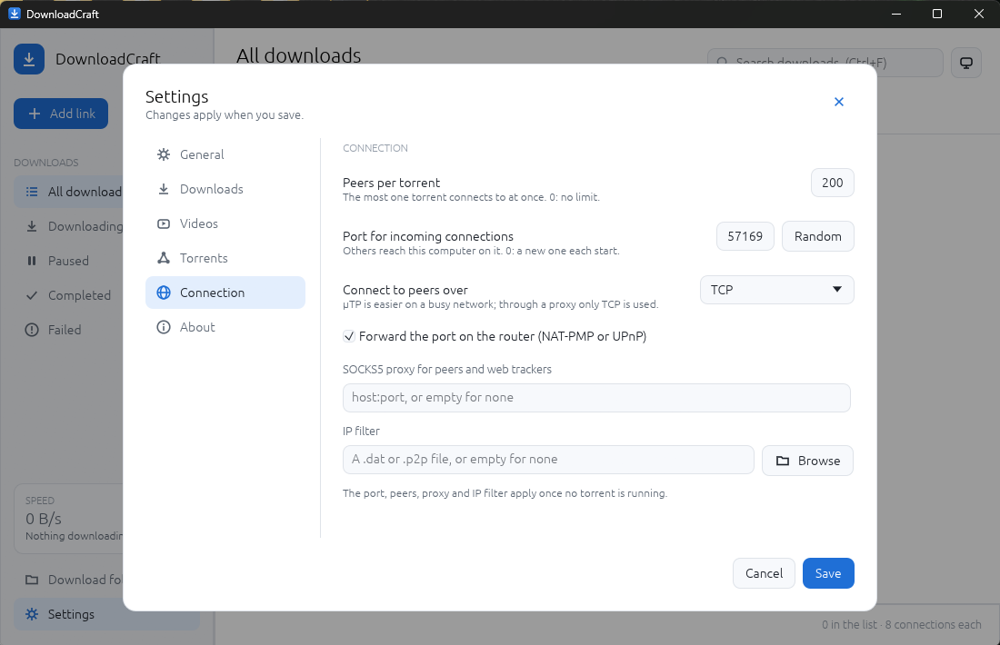

<h1 align="center">DownloadCraft</h1>

<p align="center">
  <b>One download manager for everything you download: an open-source, clean-room alternative to Internet Download Manager, rebuilt in pure Rust.</b>
</p>

<p align="center">
  Paste a link, watch it fill, pause it, close the app and carry on tomorrow from where it stopped.
  Direct links today; torrents, magnet links, MEGA and FTP on the <a href="ROADMAP.md">roadmap</a>.
  No ads, no bundled offers, no telemetry: it talks only to the servers you point it at.
</p>

<p align="center">
  
  
  
  
</p>

<p align="center">
  
</p>

<table>
<tr>
<td width="50%"><p align="center"><sub><b>Paste several links at once.</b> Each line is checked as you type: green downloads now, amber comes in a later version, red isn't a link.</sub></p></td>
<td width="50%"><p align="center"><sub><b>Light, dark or the system's</b> theme, and how many connections each download may open.</sub></p></td>
</tr>
</table>

## What works today

- **Video pages: YouTube, Vimeo, Dailymotion, Twitch, TikTok, X and more**, with the quality
  picked per video (each with its size, e.g. 1080p · 107 MB, 720p · 85 MB, Audio only). Within a
  resolution, H.264 video and AAC audio are preferred, so the file plays nearly everywhere; it's
  saved as MP4 under the video's title. This uses [yt-dlp](https://github.com/yt-dlp/yt-dlp), which
  DownloadCraft fetches on request from its official release and checks against its published
  SHA-256 (FFmpeg too, on Windows and Linux, to join video and sound, and for YouTube Deno, the
  JavaScript runtime yt-dlp reads its pages with). A playlist or channel link
  lists its videos (up to 500) and adds each, at one quality for all. Subtitles in the languages
  set in Settings come inside the video (and beside it). Only download videos you have the right
  to; DRM-protected videos aren't supported.
- **The real file name before you add it**: each link is looked at as you paste it, and the
  name comes from the server (`Content-Disposition`, else the address after redirects, with an
  extension from the file type when it has none), along with the size. A link that opens a web
  page rather than a file says so.

- **Multi-part downloads, as IDM does them**: a file is split into parts fetched on up to 16
  connections at once (8 by default), each written straight into place. A connection that
  finishes early takes over half of the biggest part left, and a connection the server turns away
  hands its part to the others. The bar shows every part filling in. On cdn.kernel.org a 140 MB
  file took 1.8 s on 8 connections against 23 s on one.
- **Downloads that resume**: a pause, a dropped connection or quitting the app keeps the partial
  file and a record of every part, and Resume asks the server for just the missing bytes. Servers
  that don't take ranges get one connection and start over, and the list says so.
- **A queue**: up to 3 downloads at once by default (1–16 in Settings); the rest wait their turn.
- **Paste anywhere**: Ctrl+V in the window opens Add link with what you copied; several links,
  one per line, add as many downloads. `downloadcraft <link>…` while it's open hands the links to
  the window already running instead of opening a second one.
- **The server's file name** (`Content-Disposition`), made safe for every file system, and
  `name (1).ext` when the name is taken.
- **Categories**: All, Downloading, Paused, Completed, Failed, with counts.
- **Right-click** a download: Resume, Pause, Open, Open folder, Copy link, Remove. Double-click a
  finished one to open it.
- **The list is kept** between runs (`downloads.json` in the app's data folder); a damaged file is
  set aside, never fatal. `downloadcraft.log` beside it says what each run did (retries, parts
  handed back, the graphics adapter); `--log` shows it in the terminal too.
- **Light, dark or the system's theme**, from the switch beside the search or Settings.
- **Search** the list by name or link (Ctrl+F), and hover a row for Pause, Resume, Open folder and
  Remove.
- **Built for agents**: every action is a command with an id, shared by the toolbar, shortcuts,
  `--cmd` and the CLI (`downloadcraft-cli get <url>`, `downloadcraft-cli commands`).

- **Show in folder**, as browsers do it: the file manager opens with the file selected
  (Explorer, Finder, and on Linux any file manager with the freedesktop FileManager1 interface).
- **Deleted files show as Deleted**: a finished file that's been deleted or moved is faded and
  struck through, as in a browser's downloads page, with **Download again**.
- **Remove asks first**, as torrent clients do, with a box to delete the file too; it goes to the
  Recycle Bin or Trash, and the box remembers how you left it.

Torrent, magnet, MEGA and FTP links are recognised now, and the Add dialog says which version
brings each.

## Installing

Test builds are on the [releases page](https://github.com/ZIDAN44/downloadcraft/releases):

| Platform | Files |
|---|---|
| Windows x64 / x86 / ARM64 | `.msi` (installs for you only, no administrator needed) or the `-portable.zip` |
| macOS (Apple silicon and Intel) | `.dmg` |
| Linux x86_64 / aarch64 | `.AppImage`, `.deb`, `.rpm`, `.flatpak`, `.tar.gz` |
| Linux riscv64, FreeBSD | `.deb`, `.rpm`, `.tar.gz` |
| Nix (Linux, Apple silicon) | `nix run github:ZIDAN44/downloadcraft`, or the flake's package and overlay |

Installed from the `.msi`, the portable zip, the `.dmg` or the `.AppImage`, DownloadCraft updates
itself: it downloads the next version in the background, checks its SHA-256, and installs it when
you restart. Releases follow releases; test builds also follow test builds. See [docs/updates.md](docs/updates.md).

## Running it from source

```bash
cargo run -p downloadcraft
```

```bash
cargo run -p downloadcraft-cli -- get https://example.com/file.zip --dir ./downloads --connections 8
```

Keyboard: Ctrl+N add link, Ctrl+V paste a link, Ctrl+F search, Space pause / resume, Delete remove,
↑ ↓ move through the list, Enter open a finished file.

## How it's built

Rust, egui, ureq over rustls. A sans-I/O engine (`crates/engine`) owns the list and the queue; the
network layer (`crates/net`) runs each transfer on a thread of its own; the UI (`crates/ui-egui`)
only calls commands. See [docs/architecture.md](docs/architecture.md) and [AGENTS.md](AGENTS.md).

```bash
cargo xtask ci
```

## Licence

MIT OR Apache-2.0. Clean room: built from the HTTP and BitTorrent specifications and public
behaviour; every asset is original (icons are drawn in code). See [ATTRIBUTION.md](ATTRIBUTION.md).
