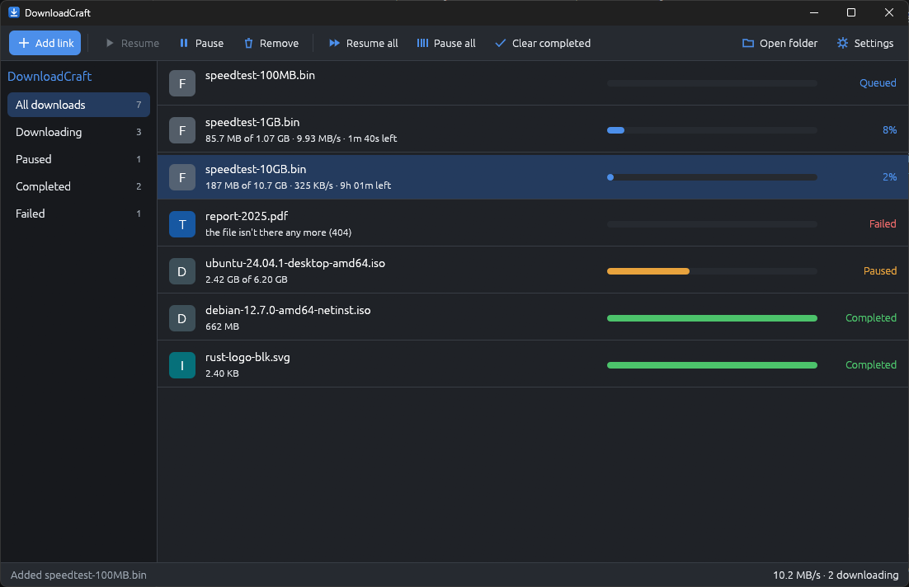
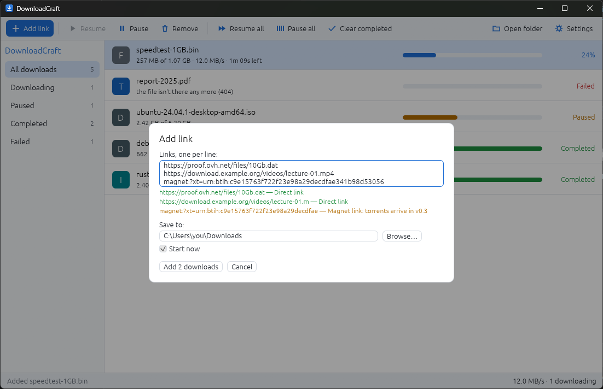

<h1 align="center">DownloadCraft</h1>

<p align="center">
  <b>One download manager for everything you download: an open-source, clean-room alternative to Internet Download Manager, rebuilt in pure Rust.</b>
</p>

<p align="center">
  Paste a link, watch it fill, pause it, close the app and carry on tomorrow from where it stopped.
  Direct links today; torrents, magnet links, MEGA and FTP on the <a href="ROADMAP.md">roadmap</a>.
  No ads, no bundled offers, no telemetry: it talks only to the servers you point it at.
</p>

<p align="center">
  
  
  
  
</p>

<p align="center">
  
</p>

<p align="center">
  
  <br><sub><b>Paste several links at once.</b> Each is checked as you type, and links a later version handles say so.</sub>
</p>

## What works today (v0.1)

- **Direct HTTP and HTTPS downloads** that **resume**: a pause, a dropped connection or quitting
  the app keeps the partial file (`name.dcpart`), and Resume asks the server for the rest with a
  byte range. Servers that don't take ranges start over, and the list says so.
- **A queue**: up to 3 downloads at once by default (1–16 in Settings); the rest wait their turn.
- **Paste anywhere**: Ctrl+V in the window opens Add link with what you copied; several links,
  one per line, add as many downloads.
- **The server's file name** (`Content-Disposition`), made safe for every file system, and
  `name (1).ext` when the name is taken.
- **Categories**: All, Downloading, Paused, Completed, Failed, with counts.
- **Right-click** a download: Resume, Pause, Open, Open folder, Copy link, Remove. Double-click a
  finished one to open it.
- **The list is kept** between runs (`downloads.json` in the app's data folder); a damaged file is
  set aside, never fatal.
- **Light and dark**, following the system.
- **Built for agents**: every action is a command with an id, shared by the toolbar, shortcuts,
  `--cmd` and the CLI (`downloadcraft-cli get <url>`, `downloadcraft-cli commands`).

Torrent, magnet, MEGA and FTP links are recognised now, and the Add dialog says which version
brings each.

## Running it

```bash
cargo run -p downloadcraft
```

```bash
cargo run -p downloadcraft-cli -- get https://example.com/file.zip --dir ./downloads
```

Keyboard: Ctrl+N add link, Ctrl+V paste a link, Space pause / resume, Delete remove,
↑ ↓ move through the list, Enter open a finished file.

## How it's built

Rust, egui, ureq over rustls. A sans-I/O engine (`crates/engine`) owns the list and the queue; the
network layer (`crates/net`) runs each transfer on a thread of its own; the UI (`crates/ui-egui`)
only calls commands. See [docs/architecture.md](docs/architecture.md) and [AGENTS.md](AGENTS.md).

```bash
cargo xtask ci
```

## Licence

MIT OR Apache-2.0. Clean room: built from the HTTP and BitTorrent specifications and public
behaviour; every asset is original (icons are drawn in code). See [ATTRIBUTION.md](ATTRIBUTION.md).
